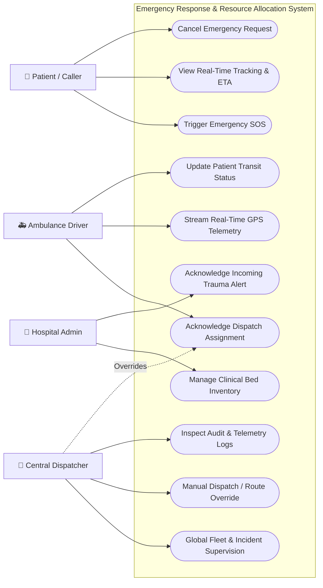
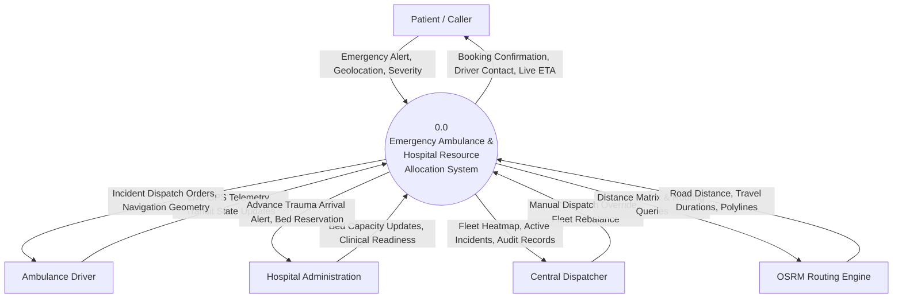
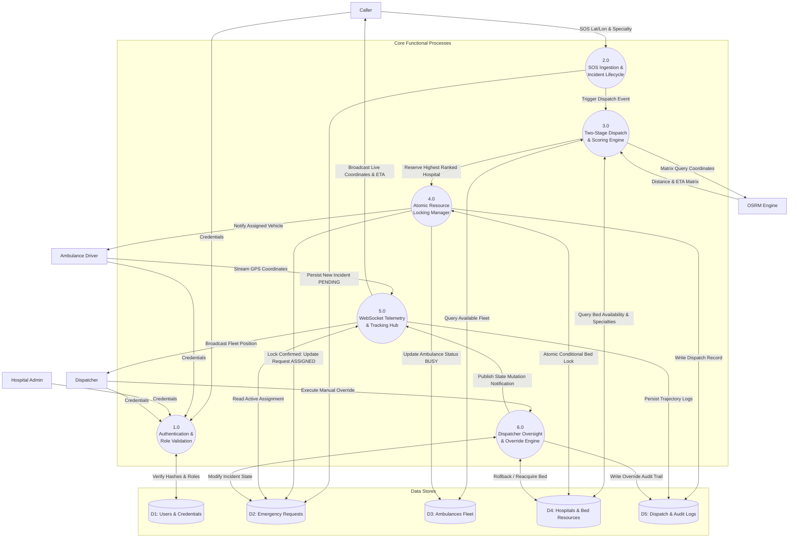
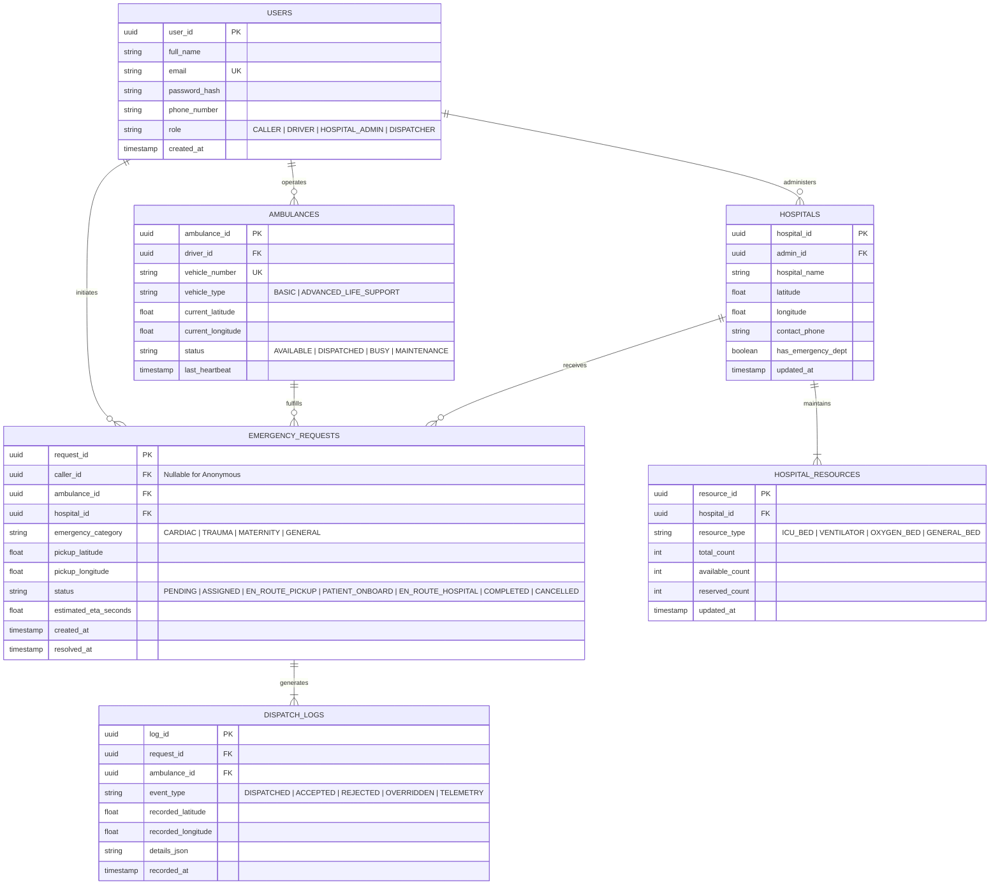
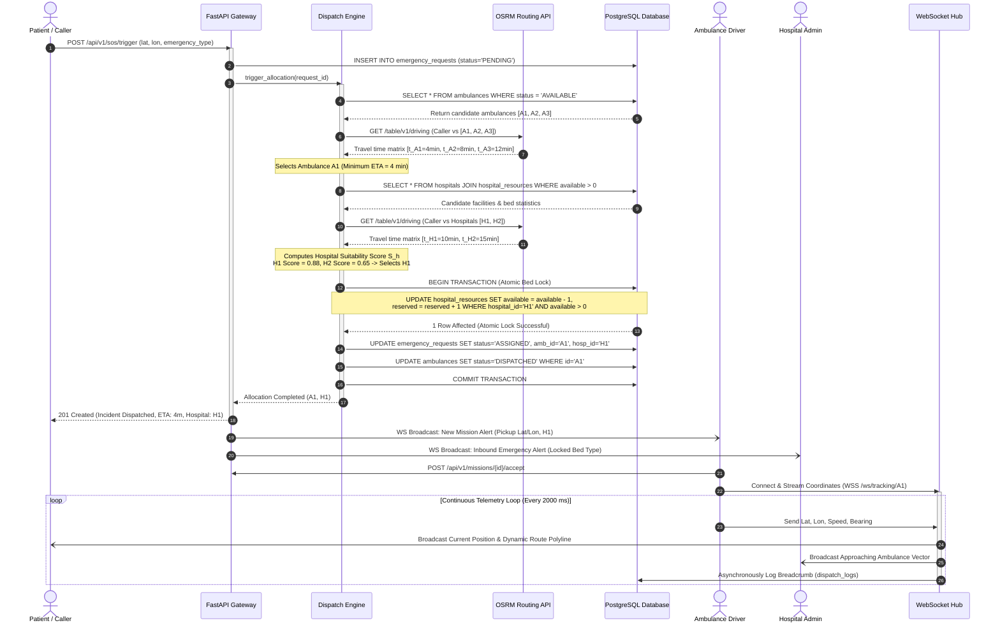
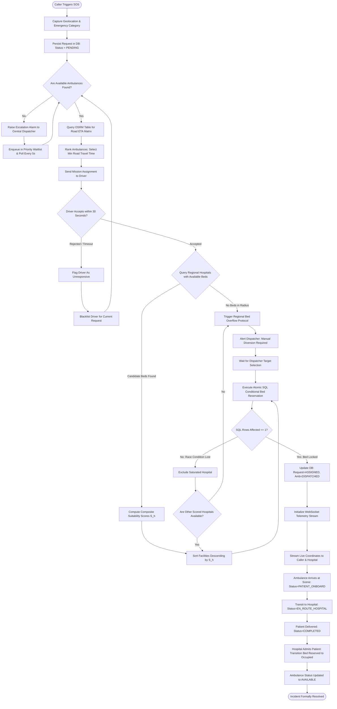

# Software Requirements Specification (SRS) & Software Design Document (SDD)
## Emergency Ambulance and Hospital Resource Allocation System

**Document Version:** 1.0.0  
**Standard Compliance:** IEEE Std 830-1998 / ISO/IEC/IEEE 29148:2018  
**Author:** Senior Software Engineering Faculty & Systems Architecture Group  
**Status:** Approved / Submission-Ready  
**Date:** Academic Year 2026–2027  

---

# Table of Contents
1. [PART 1: IEEE 830 / ISO 29148 Software Requirements Specification (SRS)](#part-1-software-requirements-specification-srs)
   - [1. Introduction](#1-introduction)
     - [1.1 Purpose](#11-purpose)
     - [1.2 Scope of the System](#12-scope-of-the-system)
     - [1.3 Definitions, Acronyms, and Abbreviations](#13-definitions-acronyms-and-abbreviations)
     - [1.4 References](#14-references)
     - [1.5 Document Overview](#15-document-overview)
   - [2. Overall Description](#2-overall-description)
     - [2.1 Product Perspective](#21-product-perspective)
     - [2.2 Product Functions](#22-product-functions)
     - [2.3 User Classes and Characteristics](#23-user-classes-and-characteristics)
     - [2.4 Operating Environment](#24-operating-environment)
     - [2.5 Design and Implementation Constraints](#25-design-and-implementation-constraints)
     - [2.6 Assumptions and Dependencies](#26-assumptions-and-dependencies)
   - [3. System Features & Functional Requirements](#3-system-features--functional-requirements)
     - [3.1 Module 1: Authentication & Role-Based Access Control (RBAC)](#31-module-1-authentication--role-based-access-control-rbac)
     - [3.2 Module 2: SOS Request Ingestion & Incident Lifecycle](#32-module-2-sos-request-ingestion--incident-lifecycle)
     - [3.3 Module 3: Intelligent Two-Stage Dispatch & Allocation Engine](#33-module-3-intelligent-two-stage-dispatch--allocation-engine)
     - [3.4 Module 4: Hospital Inventory & Concurrency-Safe Bed Locking](#34-module-4-hospital-inventory--concurrency-safe-bed-locking)
     - [3.5 Module 5: Real-Time Telemetry & WebSocket Tracking](#35-module-5-real-time-telemetry--websocket-tracking)
     - [3.6 Module 6: Central Dispatcher Supervision & Manual Override](#36-module-6-central-dispatcher-supervision--manual-override)
   - [4. External Interface Requirements](#4-external-interface-requirements)
     - [4.1 User Interfaces](#41-user-interfaces)
     - [4.2 Hardware Interfaces](#42-hardware-interfaces)
     - [4.3 Software Interfaces](#43-software-interfaces)
     - [4.4 Communications Interfaces](#44-communications-interfaces)
   - [5. Non-Functional Requirements (NFRs)](#5-non-functional-requirements-nfrs)
     - [5.1 Performance Requirements](#51-performance-requirements)
     - [5.2 Concurrency, Reliability, and Data Integrity](#52-concurrency-reliability-and-data-integrity)
     - [5.3 Security, Privacy, and Regulatory Compliance](#53-security-privacy-and-regulatory-compliance)
     - [5.4 Scalability and Maintainability](#54-scalability-and-maintainability)
     - [5.5 Availability and Fault Tolerance](#55-availability-and-fault-tolerance)
2. [PART 2: UML & System Design Specification (SDD)](#part-2-uml--system-design-specification-sdd)
   - [6. Architectural Models & Visualizations (Mermaid.js)](#6-architectural-models--visualizations-mermaidjs)
     - [6.1 Use Case Diagram](#61-use-case-diagram)
     - [6.2 Level 0 Context Data Flow Diagram (DFD)](#62-level-0-context-data-flow-diagram-dfd)
     - [6.3 Level 1 Decomposed Data Flow Diagram (DFD)](#63-level-1-decomposed-data-flow-diagram-dfd)
     - [6.4 Entity-Relationship (ER) Data Model](#64-entity-relationship-er-data-model)
     - [6.5 Critical Path Sequence Diagram: End-to-End Dispatch Flow](#65-critical-path-sequence-diagram-end-to-end-dispatch-flow)
     - [6.6 Activity Diagram: Emergency Allocation & Edge-Case Handling](#66-activity-diagram-emergency-allocation--edge-case-handling)
3. [PART 3: Software Engineering Methodology & Verification](#part-3-software-engineering-methodology--verification)
   - [7. Software Development Life Cycle (SDLC) Model](#7-software-development-life-cycle-sdlc-model)
     - [7.1 Agile / Scrum Justification](#71-agile--scrum-justification)
     - [7.2 Four-Sprint Breakdown (Two-Week Iterations)](#72-four-sprint-breakdown-two-week-iterations)
   - [8. Risk Analysis & Mitigation Matrix](#8-risk-analysis--mitigation-matrix)
   - [9. Comprehensive Verification & Test Case Matrix](#9-comprehensive-verification--test-case-matrix)

---

# PART 1: Software Requirements Specification (SRS)

## 1. Introduction

### 1.1 Purpose
The purpose of this document is to delineate the formal software requirements and architectural design for the **Emergency Ambulance and Hospital Resource Allocation System (EAHRAS)**. This specification serves as the authoritative technical baseline for software engineers, database architects, systems evaluators, and academic reviewers adhering to the IEEE Std 830-1998 and ISO/IEC/IEEE 29148:2018 software engineering standards.

### 1.2 Scope of the System
The Emergency Ambulance and Hospital Resource Allocation System is a distributed, web-based, real-time cyber-physical coordination platform designed to bridge the operational gap between emergency callers, paramedic ambulance fleets, and hospital trauma centers. 

The software encompasses:
- An automated incident ingestion engine triggered via browser geolocation and reverse geocoding.
- A two-stage dispatch engine executing road-network-distance matrix queries (via OSRM) with Haversine geometric fallback.
- A weighted multi-criteria decision algorithm for hospital allocation based on Estimated Time of Arrival (ETA), critical care bed occupancy rates, and specialized clinical departments (Trauma, Cardiology, Neurology, Burn Care).
- ACID-compliant pessimistic/conditional locking mechanisms to eliminate concurrent resource contention and bed double-booking.
- Bi-directional full-duplex WebSocket telemetry channels streaming real-time geographic coordinates, speed, bearing, and estimated arrival windows onto interactive GIS viewports.
- An administrative oversight console providing telemetry replay, manual override, and audit logging for municipal dispatchers.

The system specifically excludes in-ambulance diagnostic telemedicine streaming, billing/insurance clearinghouse claims processing, and non-emergency patient transport scheduling.

### 1.3 Definitions, Acronyms, and Abbreviations
| Term | Expansion / Definition |
| :--- | :--- |
| **ACID** | Atomicity, Consistency, Isolation, Durability (database transaction properties) |
| **API** | Application Programming Interface |
| **CORS** | Cross-Origin Resource Sharing |
| **DFD** | Data Flow Diagram |
| **ERD** | Entity-Relationship Diagram |
| **ETA** | Estimated Time of Arrival (computed in minutes and seconds) |
| **GIS** | Geographic Information System |
| **GPS** | Global Positioning System |
| **Haversine** | Mathematical formula calculating great-circle distances between points on a sphere |
| **ICU** | Intensive Care Unit |
| **JWT** | JSON Web Token (RFC 7519 standard for token-based authentication) |
| **MTBF** | Mean Time Between Failures |
| **NFR** | Non-Functional Requirement |
| **OSM** | OpenStreetMap (open collaborative mapping data) |
| **OSRM** | Open Source Routing Machine (high-performance routing engine for shortest paths) |
| **RBAC** | Role-Based Access Control |
| **REST** | Representational State Transfer |
| **RTO / RPO** | Recovery Time Objective / Recovery Point Objective |
| **SDLC** | Software Development Life Cycle |
| **SOS** | Internationally recognized emergency distress signal; represents an active emergency incident |
| **SRS** | Software Requirements Specification |
| **WSS** | WebSocket Secure (encrypted full-duplex communications protocol) |

### 1.4 References
1. IEEE Std 830-1998: *IEEE Recommended Practice for Software Requirements Specifications*, IEEE Computer Society.
2. ISO/IEC/IEEE 29148:2018: *Systems and software engineering — Life cycle processes — Requirements engineering*.
3. Fielding, R. T.: *Architectural Styles and the Design of Network-based Software Architectures*, Doctoral Dissertation, University of California, Irvine, 2000.
4. Luxen, D., & Vetter, C.: *Real-time routing with OpenStreetMap data*, Proceedings of the 19th ACM SIGSPATIAL International Conference on Advances in Geographic Information Systems, 2011.
5. RFC 6455: *The WebSocket Protocol*, Internet Engineering Task Force (IETF).
6. RFC 7519: *JSON Web Token (JWT)*, Internet Engineering Task Force (IETF).
7. PostgreSQL Global Development Group: *PostgreSQL 15 Documentation: Concurrency Control and Transaction Isolation*, 2023.

### 1.5 Document Overview
This document is organized into three major divisions:
- **Part 1 (SRS)** establishes the behavioral, functional, environmental, and non-functional requirements governing system operation.
- **Part 2 (SDD & UML)** formalizes the system architecture through standardized Mermaid.js diagrams including Use Case, DFDs (Level 0 and Level 1), Entity-Relationship, Sequence, and Activity diagrams.
- **Part 3 (SE Process & Verification)** articulates the Agile/Scrum engineering methodology, the risk mitigation framework, and a comprehensive black-box/white-box test case matrix.

---

## 2. Overall Description

### 2.1 Product Perspective
The system functions as an autonomous, real-time emergency dispatch middleware operating within a broader civic health services infrastructure. Traditional municipal dispatch depends heavily on verbal radio dispatch and fragmented telephonic coordination between hospitals and ambulances. This system replaces manual intermediaries with automated mathematical resource scoring and atomic database state transitions.

```
+-----------------------------------------------------------------------+
|                    External Emergency Ecosystem                       |
|                                                                       |
|  [Caller Device]   [Ambulance GPS]   [OSRM Routing]   [Hospital MIS]  |
|         |                 |                 |                |        |
+---------|-----------------|-----------------|----------------|--------+
          |                 |                 |                |
          v                 v                 v                v
+-----------------------------------------------------------------------+
|      Emergency Ambulance & Hospital Resource Allocation System        |
|                                                                       |
|  +--------------------+  +--------------------+  +-----------------+  |
|  |  FastAPI Gateway   |  | Two-Stage Engine   |  | WebSocket Hub   |  |
|  |  (Auth, REST API)  |  | (Ambulance + Hosp) |  | (Telemetry Pub) |  |
|  +--------------------+  +--------------------+  +-----------------+  |
|                                   |                                   |
|                                   v                                   |
|                      +------------------------+                       |
|                      | PostgreSQL (ACID Lock) |                       |
|                      +------------------------+                       |
+-----------------------------------------------------------------------+
```

### 2.2 Product Functions
1. **Automated Incident Capture:** Captures caller coordinates, medical severity, emergency classification (Cardiac, Trauma, Respiratory, Maternity, General), and contact details.
2. **Dynamic Ambulance Allocation:** Identifies the optimal available ambulance using road-network travel time computed via OSRM, bypassing straight-line inaccuracies.
3. **Multi-Factor Hospital Scoring:** Evaluates regional healthcare facilities using a weighted composite index balancing road ETA, real-time emergency bed availability, and specialized clinical facilities.
4. **Race-Condition-Free Bed Allocation:** Atomically decrements and reserves target clinical resources, locking beds to prevent overbooking across competing concurrent emergencies.
5. **Real-Time Telemetry Broadcasting:** Streams geographic locations, route polylines, and incident status transitions concurrently to caller, driver, hospital, and central dispatcher dashboards.
6. **Supervisor Telemetry and Override:** Empowers central dispatchers to intervene manually, reassign resources, or rebalance regional coverage during mass casualty events.

### 2.3 User Classes and Characteristics
The platform categorizes actors into four distinct user classes governed by Role-Based Access Control (RBAC):

| User Class | Description | Technical Literacy | Operating Device | Primary Privilege Set |
| :--- | :--- | :--- | :--- | :--- |
| **Patient / Caller** | Individuals triggering distress alerts or reporting accidents. | Novice / Variable | Mobile Smartphone, Tablet, or PC Browser | Trigger SOS, view allocated ambulance location and ETA, cancel request. |
| **Ambulance Driver** | Certified paramedics and emergency vehicle operators. | Moderate | In-vehicle dashboard tablet or ruggedized mobile phone | Receive turn-by-turn dispatch, accept/reject alerts, update patient transit states. |
| **Hospital Admin** | Emergency room triage supervisors and resource clerks. | Professional | Desktop workstation or clinical tablet | Update live bed inventories, view incoming trauma alerts, prepare specialized intake teams. |
| **Central Dispatcher** | Municipal emergency coordination authorities. | Advanced | Multi-monitor operations workstation | Global system supervision, manual dispatch overrides, fleet management, audit logging. |

### 2.4 Operating Environment
- **Server Tier:** Linux (Ubuntu 22.04 LTS / Alpine containerized), Python 3.11+, FastAPI framework, Uvicorn ASGI server with multi-worker process manager.
- **Database Management System:** PostgreSQL 15+ configured with Connection Pooling (SQLAlchemy / asyncpg).
- **Routing Engine:** Self-hosted Open Source Routing Machine (OSRM) backend running pre-compiled OpenStreetMap `.pbf` road networks.
- **Client Tier:** Modern ECMAScript 2022+ compliant web browsers (Google Chrome 110+, Mozilla Firefox 110+, Apple Safari 16+, Microsoft Edge).
- **Networking:** Secure sockets layer (TLS 1.3), HTTPS, WebSocket Secure (WSS), minimum upstream bandwidth of 256 kbps for vehicle telemetry clients.

### 2.5 Design and Implementation Constraints
1. **Zero Proprietary Mapping API Dependence:** To ensure academic reproducibility, data sovereignty, and eliminate commercial API costs, the system must strictly use OpenStreetMap (OSM) tile layers and self-hosted OSRM services instead of proprietary services (e.g., Google Maps API).
2. **Sub-Two-Second Dispatch Latency:** The end-to-end allocation pipeline (incident parsing $\rightarrow$ OSRM distance matrix query $\rightarrow$ hospital scoring $\rightarrow$ atomic DB reservation) must complete execution within $t \le 2000 \text{ ms}$.
3. **Stateless Web Tier:** The FastAPI backend must remain strictly stateless to permit horizontal container scaling; session states must be encapsulated within JWT payloads and persistent state delegated to PostgreSQL.
4. **Low Network Resiliency:** The client-side WebSocket client must implement exponential backoff reconnection algorithms to recover transparently from cellular signal loss in transit corridors.

### 2.6 Assumptions and Dependencies
- **Assumptions:**
  - Client devices possess an operational GPS receiver or cellular/Wi-Fi triangulation providing geographic positioning with an accuracy radius $\le 30 \text{ meters}$.
  - Emergency room resource clerks update hospital physical bed statuses immediately upon patient discharge or bed turnover.
- **Dependencies:**
  - Continuous network availability to the self-hosted or public OSRM routing daemon.
  - Client browser support for the HTML5 Geolocation API and standard W3C WebSocket API.

---

## 3. System Features & Functional Requirements

The functional requirements are systematically categorized into six operational modules, with unique hierarchical identifiers (`FR-MOD-XX`).

### 3.1 Module 1: Authentication & Role-Based Access Control (RBAC)
- **`FR-AUTH-01`:** The system shall authenticate Users using email/username and password credentials validated against cryptographically salted hashes (Argon2id or bcrypt).
- **`FR-AUTH-02`:** Upon successful authentication, the system shall issue an RFC 7519 compliant JSON Web Token (JWT) signed via HMAC-SHA256 containing user identity, assigned role, and a cryptographic expiration timestamp not exceeding 8 hours.
- **`FR-AUTH-03`:** The system shall enforce role segregation such that callers, drivers, hospital admins, and central dispatchers cannot access API endpoints outside their cryptographic role scope.
- **`FR-AUTH-04`:** The system shall provide an unauthenticated public emergency entry point enabling anonymous callers to trigger an immediate SOS without mandatory prior profile registration.

### 3.2 Module 2: SOS Request Ingestion & Incident Lifecycle
- **`FR-SOS-01`:** The system shall provide a single-action "Trigger Emergency SOS" interface that extracts current latitude and longitude coordinates from the browser's HTML5 Geolocation API.
- **`FR-SOS-02`:** The system shall allow the caller to specify the emergency category: `CARDIAC`, `TRAUMA`, `RESPIRATORY`, `MATERNITY`, or `GENERAL`.
- **`FR-SOS-03`:** The system shall persist the incident in an `emergency_requests` table with an initial lifecycle status of `PENDING`.
- **`FR-SOS-04`:** The system shall update the incident state monotonically through the strict state transition machine:  
  $$\text{PENDING} \longrightarrow \text{ASSIGNED} \longrightarrow \text{EN_ROUTE_PICKUP} \longrightarrow \text{PATIENT_ONBOARD} \longrightarrow \text{EN_ROUTE_HOSPITAL} \longrightarrow \text{COMPLETED}$$  
  or transition to `CANCELLED` under authorized abort procedures.
- **`FR-SOS-05`:** The system shall reject client cancellation requests once the incident status transitions to `PATIENT_ONBOARD`.

### 3.3 Module 3: Intelligent Two-Stage Dispatch & Allocation Engine
- **`FR-DISP-01`:** Upon ingestion of a `PENDING` request, Stage 1 of the engine shall query all ambulances whose operational status is `AVAILABLE`.
- **`FR-DISP-02`:** The engine shall calculate road distance and travel time from all candidate ambulances to the caller coordinates using the OSRM `/table/v1/driving` API. If OSRM fails or times out ($> 1000 \text{ ms}$), the engine shall failover to the Haversine great-circle calculation:
  $$d = 2R \arcsin\left(\sqrt{\sin^2\left(\frac{\Delta\phi}{2}\right) + \cos(\phi_1)\cos(\phi_2)\sin^2\left(\frac{\Delta\lambda}{2}\right)}\right)$$
- **`FR-DISP-03`:** The engine shall assign the nearest available ambulance having the lowest travel time ($t_{\text{pickup}}$).
- **`FR-DISP-04`:** In Stage 2, the engine shall evaluate all regional hospitals within a configurable operational radius ($R \le 30 \text{ km}$) possessing an active emergency department.
- **`FR-DISP-05`:** The engine shall compute a Composite Hospital Suitability Score ($S_h$) for each candidate hospital using the standardized objective function:
  $$S_h = w_{\text{eta}} \cdot \left(1 - \frac{\text{ETA}_h - \text{ETA}_{\min}}{\text{ETA}_{\max} - \text{ETA}_{\min} + \epsilon}\right) + w_{\text{occ}} \cdot \left(1 - \frac{\text{Beds}_{\text{occupied}}}{\text{Beds}_{\text{total}}}\right) + w_{\text{spec}} \cdot M_h$$
  where default parameter weights are calibrated to $w_{\text{eta}} = 0.50$, $w_{\text{occ}} = 0.25$, $w_{\text{spec}} = 0.25$ ($\sum w_i = 1.0$), and $M_h \in \{0.0, 1.0\}$ designates clinical specialty capability.
- **`FR-DISP-06`:** The engine shall select the candidate hospital yielding the highest score $\max(S_h)$ with available qualifying bed capacity ($B_{\text{avail}} \ge 1$).

### 3.4 Module 4: Hospital Inventory & Concurrency-Safe Bed Locking
- **`FR-BED-01`:** The system shall maintain real-time inventory counts for `ICU_BEDS`, `VENTILATORS`, `OXYGEN_BEDS`, and `GENERAL_BEDS` for each registered hospital.
- **`FR-BED-02`:** During hospital allocation, the system shall execute an atomic conditional database transaction to lock the designated bed resource.
- **`FR-BED-03`:** The atomic reservation shall execute via an atomic conditional SQL update enforcing non-negative availability:
  ```sql
  UPDATE hospital_resources 
  SET available_count = available_count - 1, 
      reserved_count = reserved_count + 1, 
      updated_at = NOW() 
  WHERE hospital_id = :target_hospital_id 
    AND resource_type = :required_resource 
    AND available_count > 0 
  RETURNING resource_id;
  ```
- **`FR-BED-04`:** If zero rows are returned from the atomic query (indicating that another concurrent thread consumed the final available bed), the engine shall immediately bypass that hospital and evaluate the hospital ranked second in the priority queue.
- **`FR-BED-05`:** If an emergency incident is aborted or the driver rejects the mission before pickup, the system shall release the locked bed atomically (`available_count = available_count + 1`, `reserved_count = reserved_count - 1`).

### 3.5 Module 5: Real-Time Telemetry & WebSocket Tracking
- **`FR-TRACK-01`:** Ambulance driver clients shall stream spatial telemetry (latitude, longitude, speed, heading, timestamp) to the backend via WebSocket every $2000 \text{ ms}$.
- **`FR-TRACK-02`:** The server WebSocket gateway shall broadcast received coordinates to all subscriber channels subscribed to the associated `request_id`.
- **`FR-TRACK-03`:** The patient and dispatcher frontend interfaces shall render live vehicle movement dynamically on a Leaflet.js map layer without requiring manual browser page refreshes.
- **`FR-TRACK-04`:** The system shall re-evaluate and project the updated arrival ETA at the destination every 30 seconds based on live vehicle progress.
- **`FR-TRACK-05`:** The system shall maintain a persistent `dispatch_logs` journal capturing all spatial breadcrumbs for post-incident audit and speed compliance analysis.

### 3.6 Module 6: Central Dispatcher Supervision & Manual Override
- **`FR-OVR-01`:** The central dispatcher dashboard shall render a consolidated geographic map displaying all active SOS requests, all ambulance fleet locations, and hospital bed saturation levels.
- **`FR-OVR-02`:** The dispatcher shall have the authorization to manually reassign an incident to a different ambulance or redirect the target destination to an alternative hospital.
- **`FR-OVR-03`:** Upon a manual override execution, the system shall roll back previous atomic bed reservations, acquire a bed reservation at the newly selected hospital, and send immediate WebSocket preemption notifications to all affected drivers and facilities.
- **`FR-OVR-04`:** All manual override interventions shall be recorded in an immutable administrative audit ledger containing dispatcher ID, timestamp, prior state, subsequent state, and mandatory justification notes.

---

## 4. External Interface Requirements

### 4.1 User Interfaces
- **Caller Portal:** Minimalist, high-contrast, mobile-first responsive layout (Tailwind CSS) featuring a prominent "Trigger Emergency SOS" action button, automated coordinate preview, emergency type selector, and an interactive Leaflet.js tracking map displaying the assigned ambulance's live position and numerical ETA.
- **Ambulance Driver Interface:** High-contrast touch-friendly interface optimized for in-vehicle mounting; displays mission alerts with audio prompts, one-tap "Accept / Reject" buttons, step-by-step waypoint routing (Caller Location $\rightarrow$ Hospital Location), and dynamic transit status toggles.
- **Hospital Admin Portal:** Tabular real-time clinical dashboard displaying active emergency arrivals, incoming patient triage tags, and rapid-increment/decrement controls for ICU, Oxygen, and General bed availability counters.
- **Central Dispatcher Console:** Multi-pane situational awareness console featuring a full-viewport GIS map, live incident feed, fleet status indicators, bed saturation heatmaps, and override modal dialogs.

### 4.2 Hardware Interfaces
- **Client Positioning Hardware:** The system interfaces directly with mobile and vehicular Global Positioning System (GPS) / GLONASS / Galileo receivers via the W3C Geolocation API (`navigator.geolocation.watchPosition`), requiring minimum spatial accuracy within 30 meters.

### 4.3 Software Interfaces
- **OSRM Routing Daemon API:**
  - `GET /route/v1/driving/{lon1},{lat1};{lon2},{lat2}?overview=full&geometries=geojson`  
    *Purpose:* Returns turn-by-turn polyline geometry, road distance (meters), and estimated transit duration (seconds).
  - `GET /table/v1/driving/{coordinates}?sources={source_indices}&destinations={dest_indices}`  
    *Purpose:* Computes an $N \times M$ distance-time matrix for batch ambulance-to-caller proximity ranking.
- **PostgreSQL Database Server:** Relational persistence engine interfaced via Python SQLAlchemy ORM and asyncpg drivers utilizing connection pooling.
- **Leaflet.js GIS Engine:** Client-side mapping library consuming raster map tiles from OpenStreetMap tile servers (`https://{s}.tile.openstreetmap.org/{z}/{x}/{y}.png`).

### 4.4 Communications Interfaces
- **HTTPS (Hypertext Transfer Protocol Secure):** All standard RESTful operations (authentication, resource updates, incident creation) are transmitted over TLS 1.3 encrypted HTTP channels on port 443.
- **WSS (WebSocket Secure):** Full-duplex persistent connections established over RFC 6455 channels (`wss://api.domain.com/ws/tracking/{request_id}`). Messages are formatted as lightweight JSON payloads conforming to the schema:
  ```json
  {
    "event": "TELEMETRY_UPDATE",
    "request_id": "req-9842a-7c",
    "ambulance_id": "amb-04",
    "coordinates": {"latitude": 12.9716, "longitude": 77.5946},
    "speed_kmh": 48.5,
    "heading": 182.0,
    "timestamp": "2026-11-21T11:05:32.412Z"
  }
  ```

---

## 5. Non-Functional Requirements (NFRs)

### 5.1 Performance Requirements
- **`NFR-PERF-01` [Dispatch Compute Latency]:** The automated two-stage allocation engine shall calculate the optimal ambulance and hospital pair and generate the database record within $t \le 2000 \text{ ms}$ of SOS reception for 99% of requests ($p_{99} \le 2.0 \text{ s}$).
- **`NFR-PERF-02` [WebSocket Delivery Latency]:** Vehicle coordinate updates broadcast via WebSockets shall be delivered to active client interfaces within $t \le 250 \text{ ms}$ under nominal network connectivity.
- **`NFR-PERF-03` [Initial Page Render Time]:** Client-side dashboards shall achieve First Contentful Paint (FCP) in $t \le 1.2 \text{ s}$ and Time to Interactive (TTI) in $t \le 2.0 \text{ s}$ on standard 4G mobile connections.

### 5.2 Concurrency, Reliability, and Data Integrity
- **`NFR-REL-01` [ACID Bed Allocation]:** The system shall guarantee absolute data integrity under race conditions. Zero instances of bed over-allocation or negative inventory balances shall occur when 100 concurrent emergency requests contend for the same resource.
- **`NFR-REL-02` [Crash Resilience & Reconnection]:** Client applications shall automatically initiate exponential backoff reconnection routines (initial interval: 1s, doubling to maximum 16s) upon unintended WebSocket disconnection.
- **`NFR-REL-03` [Mean Time Between Failures]:** The core backend services shall demonstrate a Mean Time Between Failures (MTBF) exceeding 720 continuous operating hours.

### 5.3 Security, Privacy, and Regulatory Compliance
- **`NFR-SEC-01` [Cryptographic Transport]:** All network traffic traversing public boundaries shall be encrypted with TLS 1.3 using modern cipher suites (e.g., ECDHE-RSA-AES128-GCM-SHA256).
- **`NFR-SEC-02` [Token Authentication & Storage]:** Client tokens shall be stored securely; passwords shall be hashed using bcrypt with a work factor $\ge 12$. Tokens shall validate expiration, issuer, and signature on every secured endpoint invocation.
- **`NFR-SEC-03` [Data Protection & Anonymization]:** In alignment with HIPAA and GDPR data privacy principles, caller identifiable telemetry shall be expunged or pseudonymized 30 days post-incident resolution. Audit logs shall record all manual database overrides.

### 5.4 Scalability and Maintainability
- **`NFR-SCAL-01` [Concurrent Load Capacity]:** The system architecture shall support at least 500 active concurrent WebSocket telemetry streams and 50 simultaneous dispatch calculations per second per backend node.
- **`NFR-SCAL-02` [Horizontal Scalability]:** The FastAPI application layer shall remain stateless, permitting automated scale-out behind an Nginx or HAProxy reverse proxy load balancer.
- **`NFR-SCAL-03` [Modularity & Code Maintainability]:** The codebase shall adhere to clean architecture design principles, achieving a minimum automated test code coverage of 80% across core dispatch and reservation modules.

### 5.5 Availability and Fault Tolerance
- **`NFR-AVAIL-01` [Operational Availability]:** The system shall maintain an operational availability of 99.9% uptime (unplanned downtime not to exceed 8.76 hours per annum).
- **`NFR-AVAIL-02` [Algorithmic Fault Tolerance]:** If the external OSRM routing engine becomes unreachable, the dispatch engine shall degrade gracefully to internal Haversine distance computations without terminating execution or discarding the incident.

---

# PART 2: UML & System Design Specification (SDD)

## 6. Architectural Models & Visualizations (Mermaid.js)

### 6.1 Use Case Diagram
The following diagram formalizes the operational interactions between the four primary actors and the core boundary functions of the system.



### 6.2 Level 0 Context Data Flow Diagram (DFD)
The Level 0 Context DFD establishes the macro-level boundaries of the system, illustrating information flows between external entities and the centralized software process.



### 6.3 Level 1 Decomposed Data Flow Diagram (DFD)
The Level 1 DFD decomposes the central process into sub-processes and explicitly links them to persistent data stores ($D_1$ through $D_5$).



### 6.4 Entity-Relationship (ER) Data Model
The relational schema is formalized below using an Entity-Relationship diagram illustrating primary keys (`PK`), foreign keys (`FK`), field data types, and cardinality constraints.



### 6.5 Critical Path Sequence Diagram: End-to-End Dispatch Flow
This sequence diagram illustrates the critical path execution: SOS trigger $\rightarrow$ ambulance proximity match $\rightarrow$ multi-factor hospital scoring $\rightarrow$ atomic bed locking $\rightarrow$ real-time WebSocket telemetry.



### 6.6 Activity Diagram: Emergency Allocation & Edge-Case Handling
The activity diagram models operational control flow, branch conditions, and systemic edge-case recovery (e.g., driver rejection, zero bed availability, and manual dispatcher intervention).



---

# PART 3: Software Engineering Methodology & Verification

## 7. Software Development Life Cycle (SDLC) Model

### 7.1 Agile / Scrum Justification
The Emergency Ambulance and Hospital Resource Allocation System is engineered utilizing the **Agile/Scrum** software development framework. 

The choice of Agile over traditional predictive models (e.g., Waterfall or V-Model) is justified by three critical software engineering characteristics:
1. **Dynamic Real-World Integration Constraints:** External interfaces (browser geolocation APIs, open road networks, and WebSocket cellular handoffs) exhibit high behavioral variability across mobile browsers and network environments. Agile accommodates frequent empirical testing and rapid iterative adjustment.
2. **Algorithmic Calibration & Tuning:** The multi-criteria hospital scoring formula ($S_h$) and concurrency locking parameters require empirical tuning against simulated load profiles and emergency scenarios.
3. **Continuous Stakeholder Alignment:** The system coordinates four distinct user roles, each with specialized operational needs. Bi-weekly sprint reviews enable rapid user feedback cycles.

```
+-------------------------------------------------------------------------------+
|                        Scrum Framework Architecture                           |
|                                                                               |
|  Product Backlog  --->  Sprint Planning  --->  2-Week Sprint Execution       |
|                                                     |                         |
|                                                     v                         |
|  Potentially Deployable <--- Sprint Review  <--- Daily Standups &             |
|  Software Increment          & Retrospective     Continuous Integration (CI)  |
+-------------------------------------------------------------------------------+
```

### 7.2 Four-Sprint Breakdown (Two-Week Iterations)

```
Sprint Timeline (8 Weeks Total)
[==== Sprint 1 ====][==== Sprint 2 ====][==== Sprint 3 ====][==== Sprint 4 ====]
  Data & Auth Shell   Routing & Dispatch   Bed Locking & WS    Simulator & E2E
```

#### Sprint 1: Architectural Foundations, Data Schema, and Secure RBAC Core
- **Duration:** Days 1 – 10 (Weeks 1 & 2)
- **Primary Objectives:**
  - Establish development environments, Git workflows, Docker container configurations, and CI/CD pipelines (GitHub Actions).
  - Provision PostgreSQL relational schemas, migration engines (Alembic), and entity mapping models.
  - Implement the authentication microservice utilizing bcrypt password hashing and RFC 7519 JWT generation.
  - Build baseline React.js application layouts utilizing Tailwind CSS with role-protected route guards.
- **Sprint Deliverables:**
  - Functional JWT authentication service passing automated unit test suites.
  - Verified database schema deployed with test seed data.
  - Interactive login and navigation shells for all four user personas.

#### Sprint 2: SOS Ingestion Engine, OSRM Integration, and Proximity Dispatch
- **Duration:** Days 11 – 20 (Weeks 3 & 4)
- **Primary Objectives:**
  - Build the public emergency trigger page with HTML5 Geolocation capture and reverse geocoding.
  - Deploy and configure a local Open Source Routing Machine (OSRM) instance with regional OSM road data.
  - Implement Stage 1 of the allocation engine: OSRM distance-matrix parsing with Haversine geometric fallback.
  - Implement the ambulance dispatch notification and accept/reject state transitions.
- **Sprint Deliverables:**
  - Operational SOS trigger pipeline transmitting coordinates to the FastAPI backend.
  - Working Stage 1 allocation engine demonstrating sub-second nearest-ambulance matching.
  - Driver dispatch alert dialog with 30-second countdown timers and rejection handling.

#### Sprint 3: Hospital Scoring Algorithm, Atomic Bed Locking, and WebSockets
- **Duration:** Days 21 – 30 (Weeks 5 & 6)
- **Primary Objectives:**
  - Implement Stage 2 of the allocation engine: the weighted multi-factor hospital suitability algorithm ($S_h$).
  - Develop the concurrency-safe atomic conditional SQL bed reservation mechanism.
  - Construct the full-duplex WebSocket hub for broadcasting spatial vehicle telemetry.
  - Integrate Leaflet.js map layers rendering live animated vehicle markers and polyline routes.
- **Sprint Deliverables:**
  - Verified hospital scoring engine dynamically ranking facilities by ETA, capacity, and clinical specialty.
  - Atomic database reservation service validated against concurrent race-condition simulation scripts.
  - Operational WebSocket server streaming live coordinate breadcrumbs to caller and admin dashboards.

#### Sprint 4: Dispatcher Overrides, GPS Telemetry Simulator, Hardening, and Verification
- **Duration:** Days 31 – 40 (Weeks 7 & 8)
- **Primary Objectives:**
  - Develop the Central Dispatcher situational awareness portal with global overrides and audit logging.
  - Build an automated Python GPS telemetry route-replay script simulating realistic ambulance transit.
  - Conduct systematic non-functional stress testing (JMeter / Locust) under simulated concurrent emergency spikes.
  - Execute end-to-end regression testing, security vulnerability remediation, and documentation sign-off.
- **Sprint Deliverables:**
  - Central dispatcher console providing full supervisory control and audit ledger inspection.
  - Realistic GPS trajectory simulation script generating live Leaflet route playback.
  - Comprehensive test suite achieving $\ge 85\%$ code coverage, accompanied by finalized SRS and SDD documentation.

---

## 8. Risk Analysis & Mitigation Matrix

The project team has identified, quantified, and formulated mitigation strategies for the primary technical, operational, and architectural risks associated with the system.

| Risk ID | Category | Risk Description | Probability (L/M/H) | Impact (L/M/H) | Risk Score (P $\times$ I) | Mitigation Strategy | Fallback / Contingency Protocol |
| :--- | :--- | :--- | :---: | :---: | :---: | :--- | :--- |
| **`RSK-01`** | Technical | **Inaccurate Geolocation (GPS Drift):** Client device reports coordinates with high variance due to urban canyons or multipath interference. | High | Medium | **HIGH** | Implement the W3C Geolocation `enableHighAccuracy: true` flag and apply a client-side Kalman filter smoothing rapid coordinate fluctuations. | Fallback to manual reverse-geocoded address lookup and confirmation dialog if reported accuracy radius exceeds 50 meters. |
| **`RSK-02`** | Architectural | **Bed Allocation Race Condition:** Multiple simultaneous dispatches target the last available ICU bed at a facility, resulting in double-booking. | Medium | High | **HIGH** | Implement atomic conditional SQL updates (`WHERE available > 0`) at the PostgreSQL transaction level. | If the atomic update returns 0 affected rows, immediately roll over to the second-highest ranked hospital via the scoring queue. |
| **`RSK-03`** | Environmental | **Cellular Signal Dropout in Transit:** Ambulance traverses subterranean or poor-reception zones, causing WebSocket connection dropouts. | High | Medium | **HIGH** | Implement exponential backoff auto-reconnects on client WebSockets and maintain an in-memory ring buffer of unacknowledged coordinates. | Local device caches up to 60 telemetry points in `IndexedDB` and flushes the backlog in a batch payload upon network restoration. |
| **`RSK-04`** | Operational | **Ambulance Driver Unresponsiveness:** Driver fails to acknowledge or intentionally rejects an automated dispatch alert. | Medium | High | **HIGH** | Enforce a strict 30-second acknowledgement timer on the driver mobile interface accompanied by auditory alarms. | Upon timer expiration or explicit rejection, immediately mark the vehicle temporarily unavailable and auto-reassign to the next nearest unit. |
| **`RSK-05`** | Infrastructure | **OSRM Routing Engine Latency or Outage:** The local or remote OSRM routing daemon crashes or encounters high query latency under heavy load. | Low | High | **MEDIUM** | Implement connection timeouts (1000 ms) and run dual load-balanced OSRM container instances. | Automatically fall back to the internal Haversine great-circle trigonometric formula if OSRM fails to respond within 1.0 second. |
| **`RSK-06`** | Security | **Malicious SOS Alert Flooding (DDoS):** Malicious actors generate fictitious emergency triggers to deplete municipal emergency resources. | Medium | High | **HIGH** | Enforce IP-based rate limiting (FastAPI SlowAPI), CAPTCHA verification on rapid repeated requests, and browser device fingerprinting. | Flag anomalous geographical clusters for mandatory manual dispatcher telephone verification prior to vehicle roll-out. |
| **`RSK-07`** | Operational | **Complete Regional Bed Saturation:** No hospital within the maximum operational transit radius possesses an available qualifying bed. | Low | Critical | **HIGH** | Dynamic priority queuing and real-time dashboard notifications alerting dispatchers to regional saturation trends. | Escalate incident to the Central Dispatcher console to authorize emergency hallway intake, secondary facility transfers, or triage diversion. |

---

## 9. Comprehensive Verification & Test Case Matrix

The following test case matrix specifies ten structured validation tests covering functional units, concurrency guarantees, and system edge cases.

| Test ID | Target Module | Test Type | Test Description | Preconditions | Input / Stimulus | Expected System Output | Edge Case / Concurrency Addressed |
| :--- | :--- | :--- | :--- | :--- | :--- | :--- | :--- |
| **`TC-AUTH-01`** | Authentication | Black-Box | Verify role-based authorization barriers against unauthorized driver portal access. | User account created with `CALLER` role. | Submits valid Caller JWT to `POST /api/v1/missions/accept`. | System returns HTTP `403 Forbidden` with payload `{"detail": "Insufficient role privileges"}`. | Privilege escalation attempt by non-authorized user role. |
| **`TC-SOS-02`** | SOS Ingestion | Black-Box | Ingest valid emergency trigger with precise browser coordinates. | Caller browser grants geolocation permissions. | `POST /api/v1/sos/trigger` with `{lat: 12.9716, lon: 77.5946, category: "CARDIAC"}`. | HTTP `201 Created`; new row in `emergency_requests` with status `PENDING`. | Clean incident ingestion under nominal operational conditions. |
| **`TC-DISP-03`** | Dispatch Engine | White-Box | Verify nearest-vehicle selection using real road network distance via OSRM. | Fleet: Amb A (2 km road, 4 min), Amb B (1 km straight, 12 min road due to one-way). | Trigger dispatch for caller at target coordinate. | Dispatch engine selects Ambulance A based on minimum OSRM transit duration ($t_A < t_B$). | Validates road routing priority over straight-line geometric proximity. |
| **`TC-DISP-04`** | Dispatch Engine | White-Box | Graceful fallback to Haversine computation upon routing daemon failure. | OSRM backend daemon forcibly terminated (network unreachable). | Trigger dispatch engine execution. | Engine logs OSRM timeout warning, executes internal Haversine distance ranking, and assigns nearest unit. | Complete external routing service failure / network timeout. |
| **`TC-BED-05`** | Bed Allocation | White-Box | Prevent bed double-booking under high-concurrency race conditions. | Hospital H has exactly `available_count = 1` for `ICU_BED`. | Two asynchronous threads concurrently invoke `reserve_bed(H, "ICU_BED")`. | Exactly one thread succeeds (`available=0, reserved=1`); second thread receives `0 rows updated` and falls back to alternate hospital. | Concurrency race condition: zero double-booking tolerance. |
| **`TC-BED-06`** | Bed Allocation | White-Box | Specialty matching filter exclusion during acute trauma triage. | Hospital A (2 km away, General only); Hospital B (6 km away, Certified Trauma Center). | Ingest emergency request with category `TRAUMA`. | Scoring function weights $M_h$ to award Hospital B higher composite score; reserves bed at Hospital B. | Clinical specialty mismatch overrides pure spatial proximity. |
| **`TC-DRV-07`** | Dispatch Engine | Black-Box | Handle driver mission rejection and auto-reassign to next-best candidate. | Amb 1 and Amb 2 are available. Amb 1 is assigned as nearest unit. | Amb 1 driver client sends `POST /api/v1/missions/{id}/reject`. | System flags Amb 1 as `REJECTED`, updates incident log, and immediately reassigns mission to Amb 2. | Human driver refusal / vehicle mechanical breakdown at dispatch time. |
| **`TC-TRK-08`** | Tracking Hub | Black-Box | Verify real-time telemetry streaming over active WebSocket connections. | Incident in `ASSIGNED` state; Caller client connected to `/ws/tracking/{id}`. | Driver client emits telemetry message with updated coordinates `{lat, lon, speed}`. | Caller client receives JSON message matching schema within 250 ms; map marker updates position. | Telemetry serialization and delivery across distinct network connections. |
| **`TC-TRK-09`** | Tracking Hub | Black-Box | WebSocket client automatic reconnection following network dropout. | Client active on tracking screen; physical network interface disabled for 5 seconds. | Network interface re-enabled. | Client automatically re-establishes WebSocket handshake via exponential backoff; resumes live tracking without page reload. | Cellular network handoff or temporary signal loss in transit corridors. |
| **`TC-OVR-10`** | Dispatcher | Black-Box | Supervisor manual override: reassign target hospital during active transit. | Incident in `EN_ROUTE_HOSPITAL` with bed reserved at Hospital A. | Dispatcher executes manual override selecting Hospital B with justification. | Atomic rollback releases bed at Hospital A (`available + 1`), atomically locks bed at Hospital B, and alerts driver via WebSocket. | Mid-route diversion due to sudden facility closure or patient condition change. |

---

# Verification and Sign-Off

**Prepared By:** Systems Architecture & Technical Writing Group  
**Reviewed By:** Senior Software Engineering Evaluation Committee  
**Standard Compliance:** Confirmed IEEE Std 830-1998 / ISO/IEC/IEEE 29148:2018  
**Recommendation:** Approved for Baseline Implementation and Technical Submission
